# Mascot Studio

62 animated Claude mascot states: 22 originals, 8 accessory variants, 22 extended pixel animations, and 10 extended gags. Transparent SVG exports, a React component, and a reusable coding-agent skill for creating characters, activities, and accessories.

## Standing sleep / v1.7.2

`asleep-fluid` sleeps standing in its blue nightcap, with a gentle up-and-down bob and a rising trail of Z z z. The 10.5-second loop keeps the original four legs planted. [Preview standing sleep](https://harriszed.github.io/mascot-studio/mascot/?v=1.7.2#asleep-fluid). The other 61 animations are unchanged.

## Story and weight / v1.7.0

The approved hammer animation now powers `using-tool-fluid`. The same approach has been applied to all 22 extended activities and ten gags: preparation, deliberate action, expressive poses, payoff and recovery. Delegating puts on shades and conducts floating task cards, with no little helper mascots. Quiet waiting and continuous walking keep their own rhythms.

[Compare originals and extended stories](https://harriszed.github.io/mascot-studio/mascot/fluid.html) or [watch the ten gags](https://harriszed.github.io/mascot-studio/mascot/gags.html). The original 22 animations and eight accessories are preserved. All 62 individual transparent GIFs are in the download ZIP.

## Extended pixel gags

Ten original-style visual jokes: `gag-hallucinate`, `gag-tokens`, `gag-context`, `gag-prompt`, `gag-robot`, `gag-nap`, `gag-coffee`, `gag-dance`, `gag-buffering`, and `gag-deploy`. All ten now tell longer stories (roughly 10-14 seconds), with setup, new actions, a payoff and recovery. Each has transparent SVG/GIF exports and a React state identifier. Speech-bubble captions stay in your app. Progress bars and visual question/dot symbols are part of the artwork. `gag-prompt` uses a quiet head-scratch and steady idea pose.

[Explore the gag gallery](https://harriszed.github.io/mascot-studio/mascot/gags.html) or read the [story and timing notes](sharing/ANIMATION-NOTES.md).

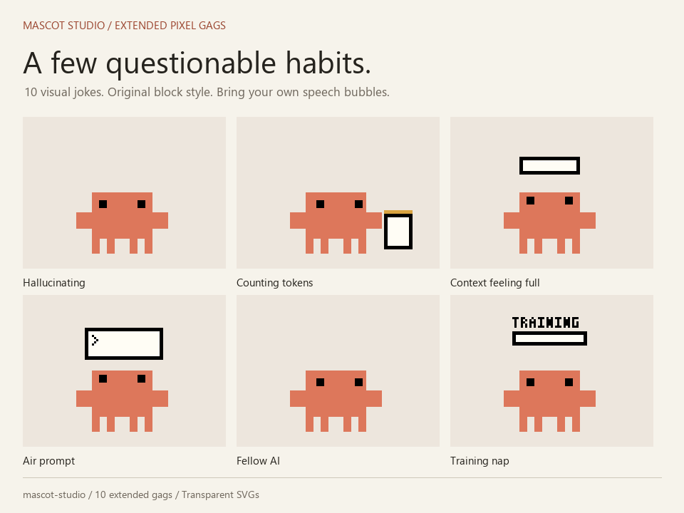

## Extended pixel animations

The `*-fluid` collection covers all 22 activities, using the original thick block actor and readable prop interactions. Highlights include weighted hammering, shades and floating task cards, standing sleep in a nightcap, two page turns and a bookmark, a corrected draft, an amber test and retry, a stamped commit, and physical memory packing. Identifiers remain compatible with the React component; original states keep their existing behavior.

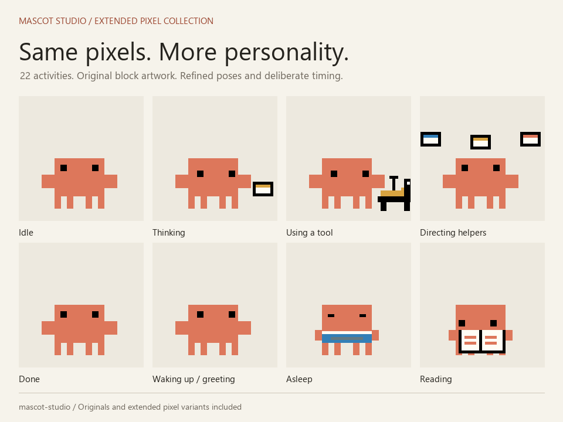

Open [the side-by-side comparison](https://harriszed.github.io/mascot-studio/mascot/fluid.html). The page also works offline from the asset pack. Each variant is available through the React `state` prop, for example `<ClaudeMascot state="greeting-fluid" />`.

[**Live playground**](https://harriszed.github.io/mascot-studio/mascot/) | [**Download v1.7.2**](https://github.com/Harriszed/mascot-studio/releases/tag/v1.7.2) | [**Creation skill**](skills/mascot-studio/SKILL.md)

[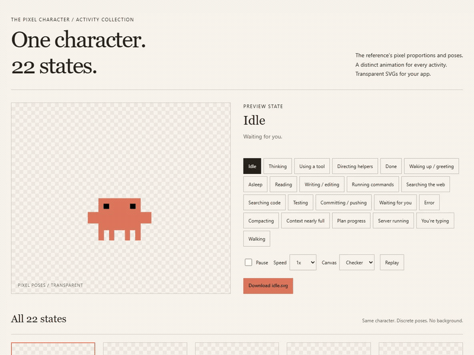](https://harriszed.github.io/mascot-studio/mascot/)

*A few of the activity states in motion. Click the preview to explore the full collection, change speed, and download individual SVGs.*

## Meet the states

<table>
  <tr>
    <td align="center"><a href="https://harriszed.github.io/mascot-studio/mascot/#idle"></a><br /><strong>Idle</strong></td>
    <td align="center"><a href="https://harriszed.github.io/mascot-studio/mascot/#thinking"></a><br /><strong>Thinking</strong></td>
    <td align="center"><a href="https://harriszed.github.io/mascot-studio/mascot/#reading"></a><br /><strong>Reading</strong></td>
    <td align="center"><a href="https://harriszed.github.io/mascot-studio/mascot/#writing"></a><br /><strong>Writing</strong></td>
  </tr>
  <tr>
    <td align="center"><a href="https://harriszed.github.io/mascot-studio/mascot/#using-tool"></a><br /><strong>Using a tool</strong></td>
    <td align="center"><a href="https://harriszed.github.io/mascot-studio/mascot/#directing-helpers"></a><br /><strong>Directing helpers</strong></td>
    <td align="center"><a href="https://harriszed.github.io/mascot-studio/mascot/#testing"></a><br /><strong>Testing</strong></td>
    <td align="center"><a href="https://harriszed.github.io/mascot-studio/mascot/#walking"></a><br /><strong>Walking</strong></td>
  </tr>
</table>

Each tile opens its state in the live playground. If your Markdown viewer shows the SVGs as still images, use the playground for full playback.

<details>
<summary>See the collection at a glance</summary>

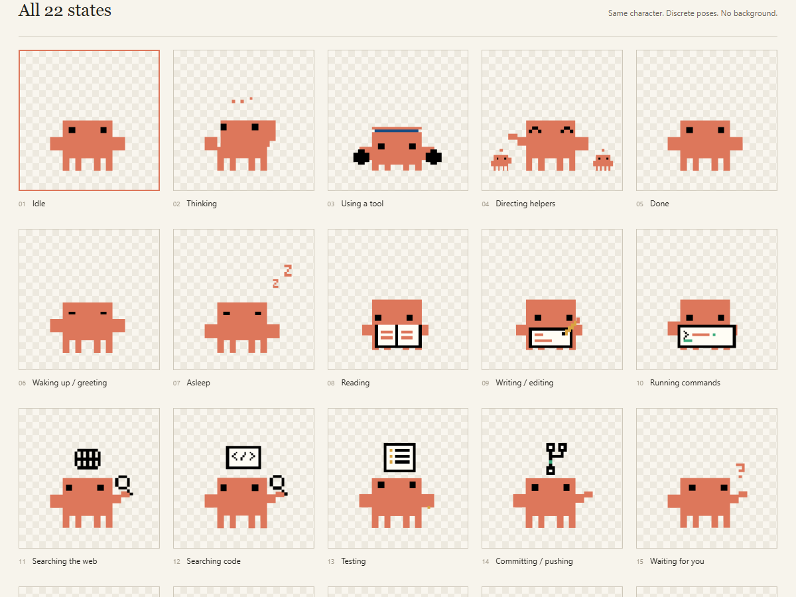

</details>

## Meet the states: made with the skill

Eight new accessory variants created with Mascot Studio. The original poses and timing stay intact; the accessories follow the character through each frame.

<table>
  <tr>
    <td align="center"><a href="https://harriszed.github.io/mascot-studio/mascot/#idle-wizard-hat"></a><br /><strong>Idle / wizard hat</strong></td>
    <td align="center"><a href="https://harriszed.github.io/mascot-studio/mascot/#thinking-wizard-hat"></a><br /><strong>Thinking / wizard hat</strong></td>
    <td align="center"><a href="https://harriszed.github.io/mascot-studio/mascot/#reading-wizard-hat"></a><br /><strong>Reading / wizard hat</strong></td>
    <td align="center"><a href="https://harriszed.github.io/mascot-studio/mascot/#writing-sunglasses"></a><br /><strong>Writing / sunglasses</strong></td>
  </tr>
  <tr>
    <td align="center"><a href="https://harriszed.github.io/mascot-studio/mascot/#running-commands-sunglasses"></a><br /><strong>Commands / sunglasses</strong></td>
    <td align="center"><a href="https://harriszed.github.io/mascot-studio/mascot/#greeting-crown"></a><br /><strong>Greeting / crown</strong></td>
    <td align="center"><a href="https://harriszed.github.io/mascot-studio/mascot/#asleep-nightcap"></a><br /><strong>Asleep / nightcap</strong></td>
    <td align="center"><a href="https://harriszed.github.io/mascot-studio/mascot/#error-propeller-cap"></a><br /><strong>Error / propeller cap</strong></td>
  </tr>
</table>

Try a brief like: ?Add wizard hats to idle, thinking, and reading; black sunglasses to writing and running commands; a crown to greeting, a nightcap to asleep, and a propeller cap to error. Keep the originals.?

## Download GIFs

[**Download all 62 individual animations as GIFs (ZIP)**](https://github.com/Harriszed/mascot-studio/releases/download/v1.7.0/mascot-gifs.zip)

One transparent GIF per state: all 22 originals, 8 accessories, 22 extended activities and 10 gags. Each is 480 x 440 pixels with crisp 2x pixel scaling and preserved colors. Done states play once and settle; the rest loop. GIF timing uses browser-safe 20ms steps, including the original walking gait. The live playground also has an individual GIF download for every state.


Save a ready-made looping showcase for Reddit, Discord, or sharing:

- [Extended pixel gags GIF](https://github.com/Harriszed/mascot-studio/releases/download/v1.7.0/gag-showcase.gif) - all ten gags, including the improved coffee break.
- [Extended activities GIF](https://github.com/Harriszed/mascot-studio/releases/download/v1.7.0/fluid-showcase.gif) - all 22 extended activities.
- [Original activities GIF](https://github.com/Harriszed/mascot-studio/releases/download/v1.7.0/mascot-showcase.gif) - a selection of original activity states.
- [Originals and accessories GIF](https://github.com/Harriszed/mascot-studio/releases/download/v1.7.0/reddit-mascot-showcase.gif) - square showcase with accessory variants.

Showcase GIFs include preview backgrounds and labels. The individual GIF ZIP has transparent backgrounds and no labels.

## Pick your download

| You want to… | Download | Includes |
| --- | --- | --- |
| Download every animation as a GIF | [Individual GIF pack](https://github.com/Harriszed/mascot-studio/releases/download/v1.7.0/mascot-gifs.zip) | 62 transparent GIFs, state manifest and attribution |
| Use the ready-made animations | [Asset pack](https://github.com/Harriszed/mascot-studio/releases/download/v1.7.0/mascot-assets.zip) | SVGs, preview, state mapping, and integration guide |
| Install the creation skill | [Mascot Studio skill](https://github.com/Harriszed/mascot-studio/releases/download/v1.7.0/mascot-studio.zip) | Skill instructions, helper script, and pipeline reference |
| Edit the mascots and create more | [Complete source](https://github.com/Harriszed/mascot-studio/releases/download/v1.7.0/mascot-studio-source.zip) | Editable project, preview, and skill together |

> Unofficial community project. Reference animation by [Ayotomiwa Wale-Durojaye](https://ayotomcs.me/claude-mascot); Claude character by Anthropic. Artwork redistribution permission remains unverified. Read [attribution and reuse status](NOTICE.md).

## Use the mascots

Extract `mascot-assets.zip` and open `index.html` in a browser. Preview states, pause/replay, change speed, and download individual SVGs. For React, copy `ClaudeMascot.tsx` and its neighbouring `artwork.json` into your app. See the [integration guide](public/mascot/README.md).

## Create more

Clone this repo or extract `mascot-studio-source.zip`. The skill needs the editable project; the asset ZIP alone is insufficient.

Install the entire `skills/mascot-studio/` folder in your coding agent's supported skill directory, including its scripts, references, and metadata. The [animation quality guide](skills/mascot-studio/references/animation-quality.md) includes researched techniques for readable poses, timing, stable pixel clusters, secondary motion and comfortable loops, adapted to the original block style. Alternatively, tell your agent to read `skills/mascot-studio/SKILL.md` in this checkout and follow it. The skill requires local file and command access.

Example brief (replace the path with your checkout):

```text
Use the mascot-studio skill with /path/to/mascot-studio.
Add a wizard hat to idle, thinking, and walking as new variants.
Keep the originals and rebuild the preview and downloadable pack.
```

You can also request an original character or new activity. Specify the activities to include. The skill edits source generators and regenerates exports.

## Run and rebuild

The SVG build and preview require Node.js 18+ without extra packages. Full releases also require Python 3.10+ and the pinned Pillow dependency. Commands work on Windows, macOS, and Linux.

```sh
npm run dev
```

Open http://127.0.0.1:3000/mascot/index.html. The generated preview also opens directly from `public/mascot/index.html`.

```sh
python -m pip install -r scripts/requirements-gifs.txt
npm run release
```

Creates four ZIP downloads in `release/`, plus the existing showcase GIFs:

- `mascot-gifs.zip`: all 62 individual transparent GIFs, manifest, guide, and notice.
- `mascot-assets.zip`: preview, SVGs, individual GIFs, references, manifests, guide, and notice.
- `mascot-studio.zip`: complete creation skill and notice.
- `mascot-studio-source.zip`: editable project, skill, and preview.

The live preview packs are refreshed at `public/mascot/claude-mascot-svg-pack.zip` and `public/mascot/claude-mascot-gif-pack.zip`.

## Source layout

| Folder | Contents |
| --- | --- |
| `public/mascot/` | Preview and exports |
| `src/components/claude-mascot/` | React component and artwork |
| `scripts/` | Drawing pipeline, preview builder, server, portable packager |
| `skills/mascot-studio/` | Portable skill and supporting resources |
| `sharing/` | Post drafts, media, and publishing guide |

See [publishing instructions](sharing/PUBLISHING.md) for releases and the hosted preview.

### Regenerate individual GIFs

SVG builds require only Node.js. GIF exports and `npm run release` additionally require Python 3.10+ and Pillow:

```sh
python -m pip install -r scripts/requirements-gifs.txt
npm run export:gifs
npm run release
```

`npm run export:gifs` writes `public/mascot/gifs/`; the release build packages them as `mascot-gifs.zip`. Authored SVG and React timelines remain unchanged.
